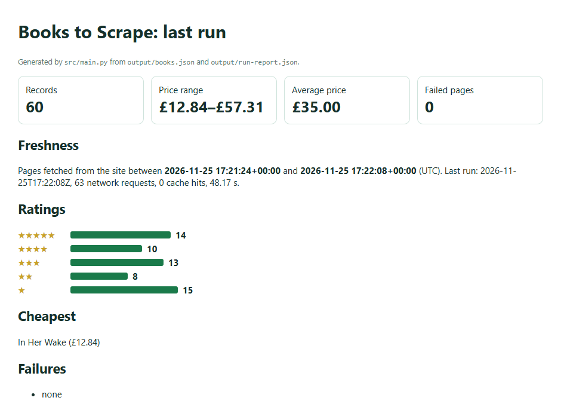

<a name="readme-top"></a>


[](https://www.linkedin.com/in/azizulabedin/)
[](https://github.com/azizulabedinazmi)
[](https://azizulabedinazmi.netlify.app/)
[](https://internship.flyrank.ai/verify?id=FR-D1-A84A9-AB526&first_name=Azizul)
[](https://www.python.org/)
[](tests/test_scraper.py)

<div align="center">
  <h3>The polite scraper</h3>
  <p>
    Downloads the first three catalogue pages of <a href="https://books.toscrape.com/">Books to Scrape</a>, visits all
    60 book pages, and turns messy HTML into clean, schema-checked JSON. It identifies itself, goes slowly, caches
    everything, survives a broken page, and ends every run with an honest report.
    <br /><br />
    FlyRank AI Internship · Backend AI Engineering · A9 (Week 5) · Python lane
  </p>
</div>

<details>
  <summary>Table of Contents</summary>
  <ol>
    <li><a href="#target">Target classification</a></li>
    <li><a href="#run">Run it (one command)</a></li>
    <li><a href="#pipeline">The pipeline</a></li>
    <li><a href="#schema">The record schema</a></li>
    <li><a href="#politeness">Politeness rules</a></li>
    <li><a href="#proof">Proof: a real run report</a></li>
    <li><a href="#failures">One bad page must not kill the run</a></li>
    <li><a href="#browser">Why no browser</a></li>
    <li><a href="#extras">Extras</a></li>
    <li><a href="#tests">Tests</a></li>
    <li><a href="#limits">Honest limitations</a></li>
    <li><a href="#ethics">Ethics</a></li>
    <li><a href="#ai-vs-me">AI vs me (bonus)</a></li>
    <li><a href="#structure">Repository structure</a></li>
    <li><a href="#about">About</a></li>
  </ol>
</details>

## 🎯 Target classification <a name="target"></a>

| Question | Answer |
|---|---|
| **Which site?** | [Books to Scrape](https://books.toscrape.com/), part of [toscrape.com](https://toscrape.com/) |
| **Why may I automate it?** | It's a **sandbox**. Its own page says it is "a fictional bookstore that desperately wants to be scraped", "a safe place for beginners learning web scraping". The books, prices and stock are fictional, and no person's data is involved. |
| **robots.txt** | I requested `https://books.toscrape.com/robots.txt` once (25 Nov 2026): **HTTP 404, no robots file found.** A missing file isn't permission; the sandbox statement above is. |
| **How much?** | Only the **first 3 catalogue pages** and the **60 book pages** they link to: 63 pages, about 1.3 MB, out of 1,000 books / 50 catalogue pages. |
| **What data?** | Per book: title, URL, price, availability, star rating, description, plus where and when it was fetched. |
| **Why is that appropriate?** | It's a public practice site built for exactly this, the scope is small and fixed, every request is identified, slow and cached, and nothing personal or behind a login is collected. |

**I will not reuse this code on another site without checking its rules and terms first.**

<p align="right">(<a href="#readme-top">back to top</a>)</p>

## ▶️ Run it (one command) <a name="run"></a>

Python 3.10+. Nothing else: no database, browser, API key or account.

```bash
git clone https://github.com/azizulabedinazmi/FlyRank_A9-Scraper.git
cd FlyRank_A9-Scraper
python -m venv .venv
.venv\Scripts\activate             # macOS/Linux: source .venv/bin/activate
pip install -r requirements.txt
python src/main.py
```

`python src/main.py` is the one command. On a fresh clone it fetches 63 pages in about 50 s (most of that is the
deliberate 0.75 s gap between requests) and writes `output/books.json` and `output/run-report.json`. **Tested from a
fresh clone: 75 s in total, `pip install` included.** Every later run reads the cache and finishes in under a second.

| Flag | What it does |
|---|---|
| *(none)* | Normal run: anything already in `cache/` is read from disk, only missing pages are fetched |
| `--refresh` | Ignore the cache and fetch everything again (use sparingly) |
| `--with-broken-url` | Add one made-up book URL to prove a bad page is logged and skipped |

Tests (offline, no network): `python -m pytest -q`

<p align="right">(<a href="#readme-top">back to top</a>)</p>

## 🔗 The pipeline <a name="pipeline"></a>

| Step | Question it answers | Where | Proof |
|---|---|---|---|
| Classify | May I automate this site? | this README | the table above |
| Fetch | Did the page really arrive? | [`src/fetch.py`](src/fetch.py) | status `200` + a cached copy in `cache/` |
| Discover | Which books are on the first 3 pages? | [`src/parse.py`](src/parse.py) `parse_catalogue` | `catalogue_pages=3, discovered=60, unique_urls=60` |
| Extract | Which parts of the page do I need? | [`src/parse.py`](src/parse.py) `parse_book` | eight raw fields per book |
| Normalize | How does `"£51.77"` become a number? | [`src/schema.py`](src/schema.py) `normalize` | `price_gbp: 51.77` next to `price_text` |
| Validate | Is every record safe to store? | [`src/schema.py`](src/schema.py) `Book`, [`src/store.py`](src/store.py) | bad records → `output/errors.json` with a reason |
| Store | Can another program use this? | [`src/store.py`](src/store.py) | `output/books.json` (+ `books.csv`) |
| Report | Did the run actually work? | [`src/main.py`](src/main.py) | `output/run-report.json` |

Discovery follows the site's own **"next" link** from page 1 and stops after 3 pages. Nothing is hardcoded but the
start URL. Every book link is relative (`a-light-in-the-attic_1000/index.html`) and is turned into an absolute URL with
`urljoin(page_url, href)`, never by gluing strings together.

<p align="right">(<a href="#readme-top">back to top</a>)</p>

## 📐 The record schema <a name="schema"></a>

Defined once in [`src/schema.py`](src/schema.py) as a Pydantic model (`strict=True`, `extra="forbid"`: wrong types
and unknown fields are errors, never silently converted). The raw text and the clean value live side by side, so every
number can be traced back to what the page said.

| Field | Type | Required | Example | Rule |
|---|---|---|---|---|
| `product_url` | str | ✓ | `https://books.toscrape.com/catalogue/a-light-in-the-attic_1000/index.html` | **canonical URL = identity**; must be `https://books.toscrape.com/...` |
| `title` | str | ✓ | `A Light in the Attic` | non-empty |
| `price_text` | str | ✓ | `£51.77` | raw, as on the page |
| `price_gbp` | float | ✓ | `51.77` | parsed from `price_text`; `0 < x < 10000`; anything that isn't `£` + a number is rejected, not guessed |
| `availability_text` | str | ✓ | `In stock (22 available)` | raw |
| `in_stock` | bool | ✓ | `true` | from `availability_text` |
| `stock_count` | int \| null | – | `22` | from `(22 available)`, `null` if not stated |
| `rating_text` | `"One"`…`"Five"` | ✓ | `Three` | raw, from the `star-rating` CSS class |
| `rating` | int | ✓ | `3` | 1–5 |
| `description` | str \| null | – | `It's hard to imagine...` | **`null` when the page has none**, never invented |
| `source_page` | str | ✓ | `https://books.toscrape.com/catalogue/page-1.html` | provenance: the catalogue page it was found on |
| `fetched_at` | datetime | ✓ | `2026-11-25T17:21:24Z` | provenance: when the site sent it (kept from the original fetch on a cache hit) |

The eight **raw** fields (`title, product_url, price_text, availability_text, rating_text, description, source_page,
fetched_at`) come straight from `parse_book`. The rest are derived from them in `normalize`.

**Idempotent:** `books.json` is rebuilt from the run's records (deduplicated by `product_url`) and written atomically
(temp file, then rename). It is never appended to, so running twice gives the same 60 records, not 120.

<p align="right">(<a href="#readme-top">back to top</a>)</p>

## 🎩 Politeness rules <a name="politeness"></a>

| Rule | Value | Why |
|---|---|---|
| User-agent | `FlyRankInternship-A9/1.0 (+https://github.com/azizulabedinazmi/FlyRank_A9-Scraper)` | says who I am and where to find me |
| Delay | **≥ 0.75 s** between two real requests (the minimum is 0.5 s) | a person clicking is slower than a loop; the site should barely notice |
| Timeout | **10 s** per request | never hang forever |
| Status check | only `200` is a page; anything else is a failed fetch, never parsed | an error page isn't data |
| Cache | every fetched page saved to `cache/` (+ a `.meta.json` with status and `fetched_at`) | development restarts read the disk; the site sees each page **once** |
| Retries | timeouts / `5xx` / `429` only: max 3 attempts, backoff 1 s → 2 s + jitter, `Retry-After` obeyed | a temporary problem gets a second chance, slowly |
| No retry | `404`, `403` and other `4xx` | asking again won't create the page, and `403` means "no" |
| Scope | 3 catalogue pages + the 60 books they list, then stop | collect only what's needed |
| Sequential | one request at a time, no concurrency | there's no rush |

<p align="right">(<a href="#readme-top">back to top</a>)</p>

## ✅ Proof: a real run report <a name="proof"></a>

`output/run-report.json` from a **fresh clone with an empty cache** (the files in [`output/`](output/) are from this run):

```json
{
  "started_at": "2026-11-25T17:21:20Z",
  "finished_at": "2026-11-25T17:22:08Z",
  "duration_s": 48.17,
  "catalogue_pages": 3,
  "book_urls_discovered": 60,
  "book_urls_unique": 60,
  "injected_test_urls": [],
  "detail_pages_parsed": 60,
  "pages_fetched": 63,
  "network_requests": 63,
  "retries": 0,
  "cache_hits": 0,
  "valid_records": 60,
  "invalid_records": 0,
  "failed_pages": 0,
  "failures": [],
  "changes_since_last_run": { "first_run": false, "new": 0, "changed": 0, "unchanged": 60, "gone": 0,
                              "changed_urls": [], "gone_urls": [] },
  "politeness": {
    "user_agent": "FlyRankInternship-A9/1.0 (+https://github.com/azizulabedinazmi/FlyRank_A9-Scraper)",
    "min_delay_s": 0.75,
    "timeout_s": 10
  }
}
```

63 pages in 48 s is 0.76 s per page: the delay *is* the speed limit, as intended. (`first_run: false` and
`unchanged: 60` are because the clone already contained the committed sample `books.json`: the freshly scraped
content matched it record for record.)

**A rerun** (same machine, cache warm): `network_requests=0, cache_hits=63, valid_records=60, duration_s=0.41`.
`books.json` still holds exactly 60 records.

**Checks on `books.json`:** 60 records · 60 unique `product_url`s · every `price_gbp` is a number · every URL starts
with `https://`. `errors.json` is `[]`. A record from it:

```json
{
  "product_url": "https://books.toscrape.com/catalogue/tipping-the-velvet_999/index.html",
  "title": "Tipping the Velvet",
  "price_text": "£53.74",
  "price_gbp": 53.74,
  "availability_text": "In stock (20 available)",
  "in_stock": true,
  "stock_count": 20,
  "rating_text": "One",
  "rating": 1,
  "description": "\"Erotic and absorbing...Written with starling power.\"--\"The New York Times Book Review \" Nan King, an oyster girl, ...",
  "source_page": "https://books.toscrape.com/catalogue/page-1.html",
  "fetched_at": "2026-11-25T17:21:25Z"
}
```

<p align="right">(<a href="#readme-top">back to top</a>)</p>

## 🧯 One bad page must not kill the run <a name="failures"></a>

Each page is handled on its own (`try` per page). A failed fetch or an unparseable page is logged, recorded in the
report, and skipped. To prove it without bothering the real site, `--with-broken-url` adds **one made-up book URL** of
my own to the list:

```text
$ python src/main.py --with-broken-url
catalogue_pages=3, discovered=60, unique_urls=60 (+1 made-up URL for the failure test)
FAILED     https://books.toscrape.com/catalogue/this-book-does-not-exist_99999/index.html reason=HTTP 404
valid_records=60, invalid_records=0, failed_pages=1, network_requests=1, cache_hits=63
```

The run finished, `books.json` still had the 60 good records, and the report said `failed_pages: 1` with the URL and
`HTTP 404`. It cost exactly **one** request: a 404 is an answer, so it isn't retried.

The retry rules themselves (503 → backoff → retry, 429 + `Retry-After: 7` → wait 7 s, three timeouts → give up,
404/403 → no retry) are tested offline with a fake session in [`tests/test_scraper.py`](tests/test_scraper.py), so
testing failure never means hammering the real site. Every network attempt is written to `output/fetch-log.jsonl` as a
structured log line:

```json
{"ts": "2026-11-25T17:21:22.362Z", "url": "https://books.toscrape.com/catalogue/page-1.html", "attempt": 1, "status": 200, "bytes": 50469, "ms": 1968, "outcome": "ok"}
```

<p align="right">(<a href="#readme-top">back to top</a>)</p>

## 🌐 Why no browser <a name="browser"></a>

**This assignment needed no browser: the data is already in the HTML the server sends, so a browser would only add
cost.** toscrape.com lists Books to Scrape as "Requires JavaScript ✘". To put numbers on it (stretch goal),
[`extras/browser_cost.py`](extras/browser_cost.py) loaded the sandbox's *JavaScript* quotes page once each way:

| | Time | Extra memory | Quotes found |
|---|---|---|---|
| Plain HTTP (`requests`) | **1.4 s** | **~6 MB** | **0**: the quotes aren't in the HTML, a script builds them |
| Real browser (Edge via Playwright) | 6.6 s | ~587 MB | 10 |

A browser is the right tool *only* when the data is created in the browser. Here it would have been ~100× the memory
for the same 60 records.

<p align="right">(<a href="#readme-top">back to top</a>)</p>

## ⭐ Extras <a name="extras"></a>

- **Retry like a pro:** exponential backoff (1 s, 2 s) with random jitter, `Retry-After` obeyed (seconds or an HTTP
  date, capped at 30 s), max 3 attempts, structured JSON logs. See [`src/fetch.py`](src/fetch.py).
- **CSV export:** `output/books.csv`. Every field is already flat, so the only flattening was: `fetched_at` → ISO-8601
  text, `null` → empty cell, booleans → `true`/`false`. Descriptions keep their commas and quotes inside properly quoted
  cells. Written with a UTF-8 BOM so Excel shows `£` correctly.
- **Changed since last run:** each record is hashed on its *content* fields (not `fetched_at`/`source_page`, which say
  when we looked, not what the book is). The report lists `new` / `changed` / `unchanged` / `gone` against the previous
  `books.json`.
- **Tiny dashboard:** `output/dashboard.html` shows records, price range, average, ratings, freshness and failures.

  

- **Selector fixtures + parser tests:** see [Tests](#tests).
- **Browser cost comparison:** see [Why no browser](#browser).
- **Not done:** *AI enrichment with Ollama.* There is no local model installed on this machine, and I'd rather leave
  it out than fake it. *Background execution* (A7) isn't part of this track yet.

<p align="right">(<a href="#readme-top">back to top</a>)</p>

## 🧪 Tests <a name="tests"></a>

`python -m pytest -q` → **29 passed in 0.4 s**, with no network. Fixtures in [`tests/fixtures/`](tests/fixtures/):

| Area | Tests |
|---|---|
| Price normalization | `£51.77` → `51.77`, `£0.99`, `£ 7`, `£100.5`; **rejected**, not guessed: `51.77`, `$51.77`, `£51.777`, `Free`, `""`, `null`, `£-3.00`, `£1,000.00` |
| URLs | relative → absolute (including `../catalogue/...`); `next` link found; last page → no next |
| Extraction | missing description → `null` with all eight keys present; a **decoy `£999.99` before the product area is ignored**; messy whitespace collapsed; a malformed page → `ParseError` |
| Duplicates | repeated URLs dropped in discovery and in storage (first one wins); `http://` and off-site URLs fail validation |
| Retry rules | 404/403/410 → one call, no retry; 503 → 200 after ~1 s backoff; `Retry-After: 7` → waits 7 s; three timeouts → give up after ~1 s + ~2 s; cache hit keeps the original `fetched_at` |
| Change detection | new / changed / unchanged / gone, and a refetch alone is *not* a change |

<p align="right">(<a href="#readme-top">back to top</a>)</p>

## ⚠️ Honest limitations <a name="limits"></a>

- **The descriptions contain the site's own glitch.** Many pages repeat a truncated preview inside the description
  ("...love th It's hard to imagine...") and end with `...more`. That *is* the page text, so the raw `description`
  keeps it verbatim. Cleaning it would mean guessing what the site meant.
- **Prices are assumed to be simple `£12.34`.** A thousands separator (`£1,000.00`) or another currency is rejected
  into `errors.json` rather than parsed. That's correct for this site, but too narrow for a real shop.
- **Selectors are tied to this layout.** If the site is redesigned, pages land in `failures` as `ParseError`. The run
  still finishes and the report shows it, but the parser needs updating.
- **The cache never expires.** Freshness is a manual `--refresh`. Fine for a fixed practice dataset, wrong for live
  prices.
- **The delay is per process.** Two copies of the scraper running at once would each wait 0.75 s, so the site would
  see twice the rate.

<p align="right">(<a href="#readme-top">back to top</a>)</p>

## 🤝 Ethics <a name="ethics"></a>

If a site offers an official API or a data export, use that instead of scraping: it's what the owner wants you to use,
and it won't break when the layout changes. Never get around a login, a paywall, a CAPTCHA or a block. Those are the
site saying no, and a block is an answer, not a puzzle. Collect only what the task needs, say who you are, go slowly,
and stop if the owner asks. I scraped Books to Scrape because it exists to be scraped. The same code pointed at a real
shop would need its terms read first, and quite possibly a different answer.

<p align="right">(<a href="#readme-top">back to top</a>)</p>

## 🤖 AI vs me (bonus) <a name="ai-vs-me"></a>

After building the pipeline by hand, I gave the same job to an AI (Claude, in a fresh session that saw only the
prompt, wasn't allowed to run anything, and had never seen this repo). Its code is kept apart in
[`ai-version/`](ai-version/); my `src/` wasn't touched.

- [`PROMPT-v1.md`](ai-version/PROMPT-v1.md) / [`v1/`](ai-version/v1/) and [`PROMPT-v2.md`](ai-version/PROMPT-v2.md) / [`v2/`](ai-version/v2/)
- **The test:** [`ai-version/checkpoint.py`](ai-version/checkpoint.py) runs the same 27 checks against any implementation.
  A small `sitecustomize` hook ([`ai-version/probe/`](ai-version/probe/)) wraps `requests`, so politeness is
  **measured from the scraper's real calls** (count, gap between call starts, user-agent, timeout), not read from its
  comments. For the failure tests it answers three pages *locally*: one fake **503**, one fake **404**, and one real page
  with its description removed and a decoy `£999.99` placed before the product. By default it also serves every other
  page from my cache (an offline mirror), so testing an AI version costs the real site nothing.
- Results: [`results-mine.md`](ai-version/results-mine.md), [`results-ai-v1.md`](ai-version/results-ai-v1.md),
  [`results-ai-v2.md`](ai-version/results-ai-v2.md), plus the first live runs (`*-live.md`)

### Prompt (v1)

```text
Write a polite web scraper in Python (requests + BeautifulSoup + Pydantic) for https://books.toscrape.com/, a practice
sandbox.

- Scope: only the first 3 catalogue pages (start at https://books.toscrape.com/catalogue/page-1.html and follow the
  "next" link), then visit every book page they list: 60 books.
- For each book, extract: title, product_url (absolute), price_text (e.g. "£51.77"), availability_text,
  rating_text (One..Five), description (null if missing), source_page (the catalogue page it was found on),
  fetched_at (ISO timestamp).
- Normalize price_text to a number price_gbp. Validate every record with a Pydantic model before storing it;
  records that fail go to output/errors.json with the reason.
- Write the valid records to output/books.json. Running the scraper twice must still give 60 records, no duplicates.
- Be polite: send a user-agent that identifies the scraper, use a timeout, wait at least 0.5 s between requests,
  only accept status 200, and cache every page to a cache/ folder so re-runs don't hit the site again.
- One broken page must not crash the run: log it and skip it. Retry once on timeouts and 5xx errors, never on 404/403.
- At the end write output/run-report.json with start time, duration, pages fetched, cache hits, valid records,
  invalid records and failed pages.
- Entry point: python src/main.py
```

### Checkpoint results

| Check | Mine | AI v1 | AI v2 |
|---|---|---|---|
| Fresh run finishes; exactly 63 requests | ✅ | ✅ | ✅ |
| **≥ 0.5 s between requests (measured)** | ✅ min 0.74 s | ❌ **min 0.499 s** (median 0.50) | ✅ min 0.74 s |
| Identifying user-agent | ✅ name + repo link | ⚠️ `PoliteBooksScraper/1.0 (educational scraper…; python-requests)`, **no contact** | ✅ name + repo link |
| Timeout on every request | ✅ 10 s | ✅ 10 s | ✅ 10 s |
| 60 records, 60 unique, numeric `price_gbp`, `https` URLs, all 8 raw fields | ✅ | ✅ | ✅ |
| Rerun: 0 requests, still 60 | ✅ | ✅ | ✅ |
| 503 → retried, skipped · 404 → 1 call, skipped · run finishes | ✅ (3 calls, backoff) | ✅ (2 calls, no pause) | ✅ (2 calls, 1.5 s pause) |
| Other 58 records survive; `failed_pages = 2` | ✅ | ✅ | ✅ |
| No description → `null`; decoy price ignored | ✅ | ✅ | ✅ |
| **Score (offline mirror)** | **27/27** | **26/27** | **27/27** |
| My malformed fixture (an error page with a price on it) | `ParseError` → failed page | **parsed as a book**: "Something went wrong", £1.00 | `ParseError` → failed page |
| Code (non-blank lines) | 452 (incl. CSV, change detection, dashboard) | 309 | 432 |

The first **live** run of v1 also showed three failures in Run C. **Those were a bug in my harness, not in v1**: it built the
doctored page from v1's cache file, which is JSON, not HTML. I proved it by replaying Run C offline, fixed the harness
to always use canonical HTML, and re-ran. The live file keeps a note saying so.

### 1. What did the AI do better, and do I understand that code?

- **A cross-check I didn't write.** v1's model has a `model_validator` that re-parses `price_text` and rejects the record if
  `price_gbp` doesn't match it. If someone later "fixes" the normalizer and breaks it, the schema catches it. Mine trusts
  `normalize()`. I understand it, and it's a good idea: validate the *relationship* between fields, not just each field.
- **Atomic cache writes.** v1 writes each cache entry to a `.tmp` file and renames it, and stores the HTML and its
  `fetched_at` in one JSON file. A crash mid-write can't leave a half page in its cache. Mine writes outputs atomically
  but not the cache, so a killed run could leave a truncated HTML file that later reads as a "cache hit".
- **Real logging.** It used the `logging` module with levels (`INFO Fetching`, `WARNING Attempt 1/2`, `ERROR Skipping`)
  where I use prints plus a JSON log file.
- v2 also refused redirects (`allow_redirects=False`), so a 3xx counts as a failure rather than silently following
  somewhere off-scope. I hadn't thought of that.

### 2. What did it get wrong or silently skip?

- **It treated the minimum as the target.** `MIN_DELAY = 0.5` and a sleep of exactly the remainder means timer and
  clock jitter put some measured gaps at **0.499 s**, under the floor the assignment set. My 0.75 s has margin.
- **It silently parsed the wrong thing.** `main = soup.select_one("div.product_main") or soup`: when the product area is
  missing, it falls back to the *whole document*. My malformed fixture (an error page with a price on it) came back as a
  book called "Something went wrong" costing £1.00. It was only kept out of `books.json` because availability happened
  to be missing too. That's exactly the "first thing that looks like a price" bug the assignment warns about, just
  hidden one level deeper.
- **It guesses URLs.** If a catalogue page fails, v1 builds the next one with `START_URL.replace("page-1", f"page-{n+1}")`.
  The assignment says to let the site tell you where the pages are.
- **An anonymous user-agent.** It said what it was but gave no way to contact anyone, and it still mentioned `python-requests`.
- **No pause before the retry.** It retried a 503 after only the normal 0.5 s, which is not much of a "wait a moment".

### 3. What did my prompt forget to say?

- "Identify yourself" without **"include a contact link"**, and "at least 0.5 s" without **"leave a margin"**: it did
  exactly what I wrote.
- I said "follow the next link" but not **"never construct URLs"**, so the fallback guess was fair game.
- I asked for `description: null if missing` but never said **what to do when the product area itself is missing**,
  so it chose "parse the whole page" over "fail the page".
- I didn't say how long to wait before the retry, or that a cache hit must keep the *original* `fetched_at`. (v1 got
  the second one right on its own.)

### Rematch (v2)

[`PROMPT-v2.md`](ai-version/PROMPT-v2.md) added: a user-agent with a contact URL, 0.75 s "because 0.5 is a floor, not
a target", never construct URLs, scope every selector and fail the page if the product area is missing, wait 1–2 s
before the retry, and keep the original `fetched_at` on a cache hit. **v2 passed 27/27**, turned the malformed page into a
`ParseError`, and added the redirect refusal on its own.

**Lesson:** v1 looked finished. It ran first time, collected 60 books and survived a 404. Its two real flaws (a delay
with no margin, and a parser that quietly reads the wrong part of a broken page) only showed up because I measured the
gap between requests instead of trusting `MIN_DELAY = 0.5`, and because I'd already written a malformed-page fixture
for my own parser. Building it myself is what told me where to look. And the one time my harness disagreed with the
AI, the bug was mine: checking the checker is part of the job.

<p align="right">(<a href="#readme-top">back to top</a>)</p>

## 🗂️ Repository structure <a name="structure"></a>

| Path | Purpose |
|---|---|
| `src/main.py` | The one command: discover → fetch → extract → validate → store → report |
| `src/fetch.py` | Polite fetching: user-agent, timeout, delay, status check, cache, retry rules, JSON logs |
| `src/parse.py` | `parse_catalogue` (links + next page) and `parse_book` (the eight raw fields) |
| `src/schema.py` | `normalize()` and the Pydantic `Book` schema |
| `src/store.py` | Validate, deduplicate by canonical URL, atomic JSON writes |
| `src/extras.py` | CSV export, change detection, dashboard |
| `output/` | Sample output from a clean run: `books.json`, `errors.json`, `run-report.json`, `books.csv`, `dashboard.html`, `fetch-log.jsonl` |
| `tests/` | 29 offline tests + HTML fixtures |
| `extras/browser_cost.py` | Stretch: plain HTTP vs real browser on `quotes.toscrape.com/js` (optional deps) |
| `ai-version/` | Bonus: both AI versions, both prompts, the 27-check harness + `requests` probe, all results |
| `docs/` | Animated banner (`make_banner.py` → `banner.svg`) and the dashboard screenshot |
| `cache/` | Raw HTML cache: created by the first run, **git-ignored** |

<p align="right">(<a href="#readme-top">back to top</a>)</p>

## 👋 About <a name="about"></a>

Built by **Azizul Abedin Azmi**, Machine Learning Intern at [FlyRank AI](https://www.flyrank.ai/), as assignment
**A9: The polite scraper** of the Backend AI Engineering track of the [FlyRank AI Internship](https://internship.flyrank.ai/).
Earlier in this track: [FlyRank_BE-01](https://github.com/azizulabedinazmi/FlyRank_BE-01) (CRUD API → Postgres in
Docker) · [FlyRank_BE-03](https://github.com/azizulabedinazmi/FlyRank_BE-03) (Supabase auth).

[](https://internship.flyrank.ai/verify?id=FR-D1-A84A9-AB526&first_name=Azizul)

[LinkedIn](https://www.linkedin.com/in/azizulabedin/) · [Portfolio](https://azizulabedinazmi.netlify.app/) · MIT License

<p align="right">(<a href="#readme-top">back to top</a>)</p>
